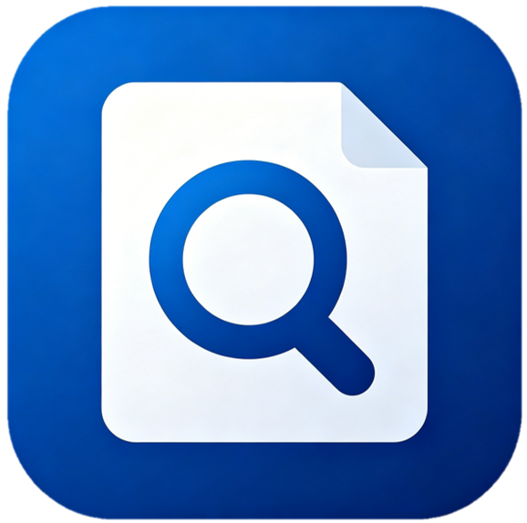
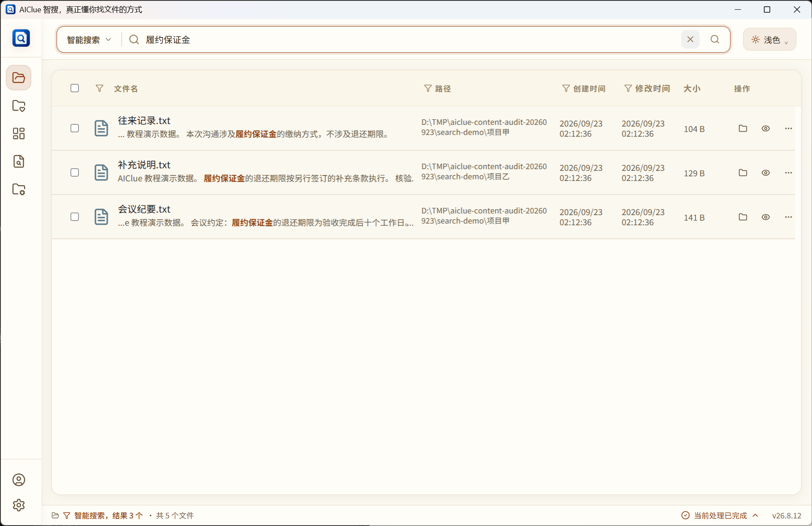
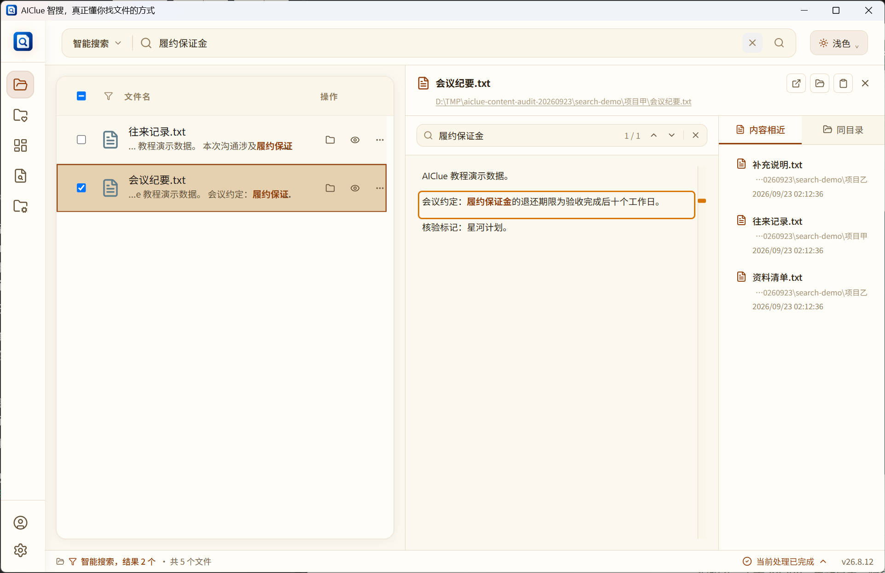

  
  <h1>AIClue</h1>
  
<strong>Search the files on your computer like searching the web.</strong>

  

    <a href="readme.md">简体中文</a>
  

  

    <a href="https://aiclue.boxai365.com/en/download/?utm_source=github&amp;utm_medium=referral&amp;utm_campaign=aiclue_repository"><strong>Download AIClue</strong></a>
    ·
    <a href="https://aiclue.boxai365.com/en/?utm_source=github&amp;utm_medium=referral&amp;utm_campaign=aiclue_repository">Official website</a>
    ·
    <a href="https://aiclue.boxai365.com/en/docs/?utm_source=github&amp;utm_medium=referral&amp;utm_campaign=aiclue_repository">User manual</a>
  

*Recorded in v26.8.12 with the Chinese interface: a remembered phrase returned three candidates among five demonstration files. A match is a starting point, not yet a confirmed file.*

AIClue is a local file search and organizing tool for Windows. Type the few words you remember to search **filenames, file locations, and document text** together. Then verify a candidate, follow it to related material, and bring useful files together.

AIClue can attempt to read text from common Word, PDF, Excel, PowerPoint, TXT, and Markdown files. See the [supported formats guide](https://aiclue.boxai365.com/en/docs/appendix-supported-formats-data.html?utm_source=github&utm_medium=referral&utm_campaign=aiclue_repository) for conditions and limits.

## From one clue to a set of files

1. **Find it:** Search from a remembered name, location, or phrase in a document.
2. **Make sure:** Check the full path, matching snippet, and preview before choosing a file.
3. **Follow the clues:** Continue from that file to similar content or other files in its folder, without guessing another query.
4. **Bring it together:** Add useful files to a workspace across folders while the originals stay where they are.

In the [recorded v26.8.12 walkthrough](https://aiclue.boxai365.com/en/find-file-without-name/?utm_source=github&utm_medium=referral&utm_campaign=aiclue_repository), the remembered phrase 履约保证金 (“performance bond”) leads to candidate files. A project-location clue narrows the search, and the preview confirms the meeting notes.

## Find one file. Follow it to more.

The first file you find may not be the final one, but it can lead you to the rest of the material. AIClue offers two distinct ways to continue from the current file:

- **Similar content:** Explore files with content close to the current file, including material in other folders.
- **Same folder:** See other files stored alongside the current file.

*Recorded in v26.8.12 with the Chinese interface: while previewing meeting notes from Project A, Similar content also shows additional notes from Project B.*

## Bring files together. Keep originals where they are.

Add a useful file to a workspace as you find it. Files from different folders can be viewed and opened together; the workspace keeps references instead of copying or moving the originals. You can also review newly received files by date and check duplicates in groups, then organize them when needed.

## Local-first, with you in control

- AIClue processes the folders you explicitly add; everyday file search and preview mainly run on your device.
- Moving, deleting, and cleaning up duplicate files require your confirmation.
- Account login, entitlement synchronization, and software updates require network access.

Read the [AIClue Privacy Policy](https://aiclue.boxai365.com/en/privacy/?utm_source=github&utm_medium=referral&utm_campaign=aiclue_repository) for the full boundaries. Currently published features are free forever, and basic features do not require registration.

## Download and install

Get the current Windows installer from the [official AIClue download page](https://aiclue.boxai365.com/en/download/?utm_source=github&utm_medium=referral&utm_campaign=aiclue_repository). You can also download the installer whose name ends in `-setup.exe` from this repository's [Releases](https://github.com/Tiller-Mu/aiclue/releases/latest) page.

> The `Source code (zip)` and `Source code (tar.gz)` archives automatically shown by GitHub are not AIClue installers and do not contain the application source code.

### System requirements

| Item | Minimum | Recommended |
| --- | --- | --- |
| Windows | Windows 10 64-bit, 4GB RAM | Windows 10/11 64-bit, 8GB+ RAM |
| Disk | 500MB free space for the app and search data | 1GB+ free space |
| Network | Required for downloads, automatic updates, account login, and entitlement synchronization | Everyday scanning, search, and preview can be used offline |

When you add many files for the first time, AIClue needs time to read file information and prepare local search data. Everyday search and browsing become smoother after this initial preparation finishes.

## Learn more

- [Official website](https://aiclue.boxai365.com/en/?utm_source=github&utm_medium=referral&utm_campaign=aiclue_repository)
- [Download AIClue](https://aiclue.boxai365.com/en/download/?utm_source=github&utm_medium=referral&utm_campaign=aiclue_repository)
- [User manual](https://aiclue.boxai365.com/en/docs/?utm_source=github&utm_medium=referral&utm_campaign=aiclue_repository)
- [Changelog](https://aiclue.boxai365.com/en/changelog/?utm_source=github&utm_medium=referral&utm_campaign=aiclue_repository)
- [Privacy Policy](https://aiclue.boxai365.com/en/privacy/?utm_source=github&utm_medium=referral&utm_campaign=aiclue_repository)

## About this repository

This is AIClue's public release repository. It provides verified Windows installers, release manifests, and signature files. It does not contain the AIClue application source code.

To report a problem or share a suggestion, use the feedback form in AIClue's Account Center or email [aiclue@boxai365.com](mailto:aiclue@boxai365.com).
