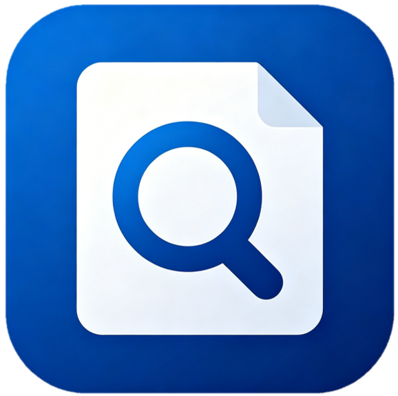
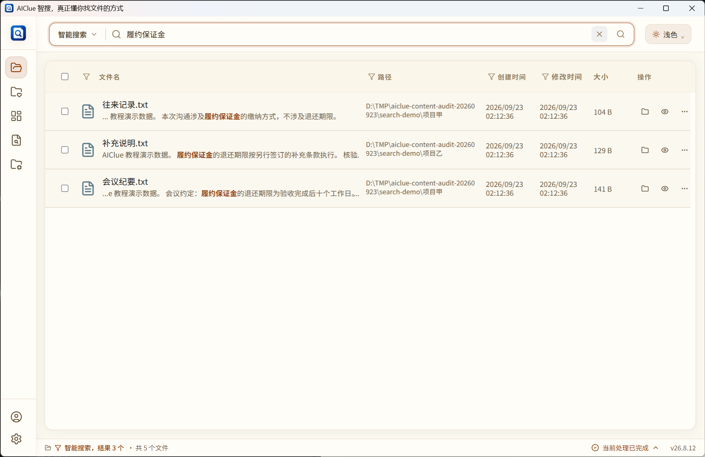
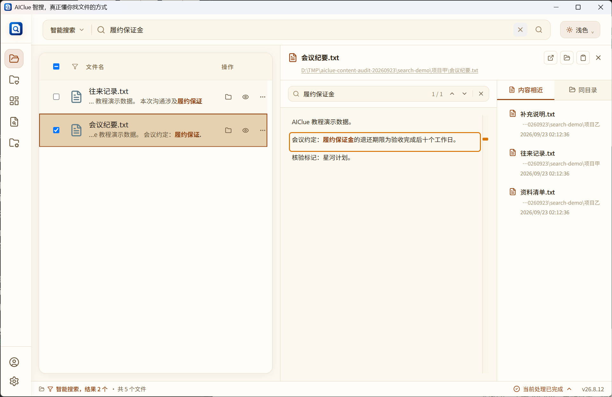

  
  <h1>AIClue 智搜</h1>
  
<strong>像搜网页一样，找电脑里的文件。</strong>

  

    <a href="README.en.md">English</a>
  

  

    <a href="https://aiclue.boxai365.com/zh/download/?utm_source=github&amp;utm_medium=referral&amp;utm_campaign=aiclue_repository"><strong>下载 AIClue</strong></a>
    ·
    <a href="https://aiclue.boxai365.com/zh/?utm_source=github&amp;utm_medium=referral&amp;utm_campaign=aiclue_repository">官方网站</a>
    ·
    <a href="https://aiclue.boxai365.com/zh/plans/?utm_source=github&amp;utm_medium=referral&amp;utm_campaign=aiclue_repository">功能与价格</a>
    ·
    <a href="https://aiclue.boxai365.com/zh/docs/?utm_source=github&amp;utm_medium=referral&amp;utm_campaign=aiclue_repository">用户说明书</a>
  

*中文界面实测：从五份演示文件中搜出三份候选。命中只是起点，还需要确认哪一份才是目标。*

AIClue 是一款面向 Windows 的本地文件搜索与整理工具。文件名记不全时，输入还记得的几个字，就能一起查找**文件名、所在位置和文档正文**；找到候选后，继续确认内容、寻找相关资料，再把有用文件聚到一起。

常见的 Word、PDF、Excel、PowerPoint、TXT 和 Markdown 文件都可以直接搜索正文；注册登录后还可免费开启本机图片文字识别（OCR），直接搜出图片和扫描件里的文字，Pro 还能识别扫描版 PDF 及 Word、PowerPoint 等文档内图片里的文字（模型随软件内置，在本机离线完成，不上传文件）。具体范围见[支持格式说明](https://aiclue.boxai365.com/zh/docs/appendix-supported-formats-data.html?utm_source=github&utm_medium=referral&utm_campaign=aiclue_repository)。

## 从一点线索，找回一组资料

1. **找得到**：用文件名、所在位置或正文线索找到候选文件。
2. **看得准**：结合完整路径、命中片段和预览，确认是不是要找的那一份。
3. **顺着找**：从当前文件继续查看内容相近或同目录的文件，不必重新猜关键词。
4. **聚起来**：把有用资料加入工作区，跨目录集中查看，原文件留在原处。

在[真实查找演示](https://aiclue.boxai365.com/zh/find-file-without-name/?utm_source=github&utm_medium=referral&utm_campaign=aiclue_repository)中，只记得“履约保证金”也能先找到候选，再利用项目位置缩小范围，最后在预览中确认目标会议纪要。

## 找到一个，再顺着找到一批

第一次搜到的文件不一定是最后需要的那份，却可能是继续找资料的线索。AIClue 在文件旁提供两个不同入口：

- **内容相近**：从当前文件继续查看内容接近的资料，相关文件可能位于其他目录。
- **同目录**：沿着当前文件的保存位置，查看同一文件夹中的其他文件。

*中文界面实测：预览项目甲的会议纪要时，右侧“内容相近”还列出项目乙的补充说明。*

## 资料聚在一起，文件留在原处

找到一份有用资料，就可以加入工作区；不同目录的文件能集中查看和打开。工作区保存的是文件引用，不会为了归集资料而复制或移动原文件。新收到的文件可以按日期回看，重复文件也能分组核对，需要时再整理。

## 本地优先，操作由你确认

- 只处理你明确添加的文件夹；日常文件搜索和预览主要在本机完成。
- 需要出门在外找资料时，Pro 用户可开启“手机互联”，通过加密连接让手机浏览器直接搜索、查看和下载电脑上指定文件夹里的文件（首次连接经双端数字核对并在电脑确认，搜索仍在电脑本机完成，不把文件传上云盘）。
- 移动、删除和清理重复文件等操作需要你确认。
- 账号登录、权益同步、套餐购买、手机互联连接和主动软件更新需要联网；启用自动检查更新或软件运行时默认每日活跃统计也会产生必要联网请求。

具体边界请阅读 [AIClue 隐私政策](https://aiclue.boxai365.com/zh/privacy/?utm_source=github&utm_medium=referral&utm_campaign=aiclue_repository)。支持免注册试用，注册登录后即可使用免费功能（含图片文字识别）；Pro 还支持识别扫描版 PDF 等文档内图片文字，并可通过加密连接让手机搜索和下载电脑文件，详见[功能与价格](https://aiclue.boxai365.com/zh/plans/?utm_source=github&utm_medium=referral&utm_campaign=aiclue_repository)。

## 下载与安装

请从 [AIClue 官方下载页面](https://aiclue.boxai365.com/zh/download/?utm_source=github&utm_medium=referral&utm_campaign=aiclue_repository) 获取当前 Windows 安装程序。也可以在本仓库的 [Releases](https://github.com/Tiller-Mu/aiclue/releases/latest) 页面下载名称以 `-setup.exe` 结尾的安装包。

> GitHub 自动显示的 `Source code (zip)` 和 `Source code (tar.gz)` 不是 AIClue 安装程序，也不包含应用源代码。

### 系统要求

| 项目 | 最低配置 | 推荐配置 |
| --- | --- | --- |
| Windows | Windows 10 64 位，4GB 内存 | Windows 10/11 64 位，8GB 以上内存 |
| 磁盘 | 500MB 可用空间（应用和搜索数据） | 1GB 以上可用空间 |
| 网络 | 下载、自动更新、账号登录、权益同步、套餐购买、手机互联及每日活跃统计时需要 | 日常扫描、搜索、本地 OCR 和预览可离线使用 |

首次添加大量文件时，AIClue 需要一些时间读取文件信息并准备本地搜索数据；完成后，日常搜索和浏览会更加流畅。

## 了解更多

- [官方网站](https://aiclue.boxai365.com/zh/?utm_source=github&utm_medium=referral&utm_campaign=aiclue_repository)
- [功能与价格](https://aiclue.boxai365.com/zh/plans/?utm_source=github&utm_medium=referral&utm_campaign=aiclue_repository)
- [下载 AIClue](https://aiclue.boxai365.com/zh/download/?utm_source=github&utm_medium=referral&utm_campaign=aiclue_repository)
- [用户说明书](https://aiclue.boxai365.com/zh/docs/?utm_source=github&utm_medium=referral&utm_campaign=aiclue_repository)
- [更新记录](https://aiclue.boxai365.com/zh/changelog/?utm_source=github&utm_medium=referral&utm_campaign=aiclue_repository)
- [隐私政策](https://aiclue.boxai365.com/zh/privacy/?utm_source=github&utm_medium=referral&utm_campaign=aiclue_repository)

## 关于本仓库

本仓库是 AIClue 的公开发布仓库，用于提供经过验证的 Windows 安装包、发布清单和签名文件，不包含 AIClue 应用源代码。

如果你在使用中遇到问题或有建议，可以在 AIClue 的账号中心提交反馈，或发送邮件至 [aiclue@boxai365.com](mailto:aiclue@boxai365.com)。
